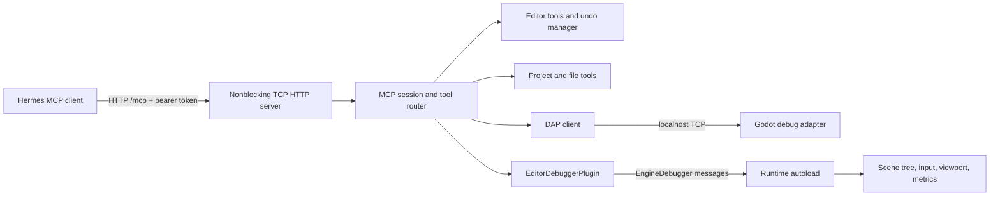

# Architecture

`plugin.gd` owns lifecycle, configuration, the editor dock, token generation and
the event buffer. `_process` polls the HTTP and DAP sockets without blocking.
`_exit_tree` closes connections and removes the debugger extension and dock.
The autoload is registered during plugin enable/startup and removed on disable.

`core/http_server.gd` handles fragmented HTTP/1.1 input and partial writes. It
validates Host, Origin and bearer authorization before dispatch. It caps headers,
body size, clients and receive time, and closes each connection after one response.
HTTP keep-alive and chunked uploads are unnecessary for the supported MCP clients;
chunked requests are rejected explicitly. JSON responses are valid Streamable HTTP;
server-initiated SSE is optional and deliberately not advertised.

`core/protocol.gd` negotiates MCP versions and sessions, validates tool inputs,
serializes execution, and returns standard JSON-RPC errors or MCP `isError` tool
results. GDScript's JSON parser reads all JSON numbers as floats; integer request
IDs are normalized before replies to remain compatible with strict MCP SDKs.
Tools provide both text and structured results; screenshots use MCP image blocks.

`tools/catalog.gd` is the single source of tool schemas and validation. The
project/editor handlers operate on the main thread, as Godot editor APIs require.
Long-lived bridge and DAP requests yield to frames rather than blocking sockets.
The schema and tagged-value validators reject malformed inputs before touching
Godot objects. `core/codec.gd` converts typed Godot values without recursively
serializing the object graph; object IDs and resource paths are explicit handles.

`core/debugger_bridge.gd` registers the `hermes_mcp` debugger message prefix. Each
runtime session announces readiness. Requests carry monotonic IDs; replies are
matched by both ID and session. Stopping a session resolves its pending requests
with an error. Normal runtime tools are rejected during a debugger break.

`runtime/runtime_bridge.gd` is the only installed autoload. It opens no sockets.
It activates only in an editor binary with an active debugger and outside the
editor scene tree. It defers captured debugger requests to the game loop and
uses `PROCESS_MODE_ALWAYS` so SceneTree pause does not disable inspection.

`core/dap_client.gd` speaks framed DAP to Godot's built-in adapter. This preserves
Godot's native breakpoint, stack, scope, variable and evaluation semantics. DAP
events are collected alongside bridge events. Closing this client disconnects
the socket rather than issuing DAP `disconnect`, which can stop a game when the
native adapter considers it a launched session.

## Extending

1. Add a schema and clear description in `tools/catalog.gd`.
2. Route the tool in `core/protocol.gd` and implement it in the relevant handler.
3. Use `Codec.error` for expected failures and `Codec.encode` for return values.
4. For scene changes, create an editor undo action and preserve scene ownership.
5. Add a real-engine integration test covering an observable result or failure.

GDScript has no general try/catch. Validate before invoking engine APIs; arbitrary
user GDScript still has the same crash/hang risks as any editor tool script. The
outer timeout prevents an asynchronous HTTP request from waiting forever, but
retains the tool lock until completion to avoid interleaving ongoing mutations.
